# Jesús Marroquín

**Specialist Backend Developer** · Mérida, Mexico

 

 

## About

I build backend and distributed systems, mostly in **C# / .NET**, and I'm most useful where several services, vendors and teams have to behave as one system. That means APIs, integrations, infrastructure, and the testing needed to trust them.

I'm used to turning incomplete, shifting requirements into working software, and to payment and enterprise integrations where failure paths matter more than happy paths. I care about reliability: knowing how a system breaks, and proving it behaves when it does.

## Engineering focus

| | |
|---|---|
| **Backend & distributed systems** | REST APIs, microservices, multi-tenant and integration-heavy applications, payments and enterprise integrations |
| **Cloud & infrastructure** | AWS (API Gateway, Lambda, S3, ECS/ECR), Docker and Docker Compose, CI/CD with Azure DevOps |
| **Identity & security** | Authentication and authorization, service identity, token and credential lifecycle |
| **Workflow orchestration** | Temporal, Redis, relational databases |
| **Testing & reliability** | Automated, integration, contract and end-to-end testing; debugging across service boundaries |
| **Quantitative engineering** | Modeling, optimization and risk thinking applied to financial systems (see [background](#background)) |

## Tech stack

**Core** &nbsp; C# · .NET · TypeScript · JavaScript · Python · PostgreSQL · SQL · C 
 
 
**Cloud & delivery** 
 
 
**Data & systems** &nbsp; Redis · Temporal · SAP 
&nbsp;&nbsp;&nbsp;&nbsp; 
 
**Frontend exposure** 
 
 
**Also Data Analysis** &nbsp; R · Power BI · Excel · SAS 
&nbsp;&nbsp;&nbsp;&nbsp;&nbsp;&nbsp;

## AI-assisted engineering

I use coding agents (**Claude Code, Codex, OpenCode, DeepSeek**) for repository and requirement analysis, implementation planning, code review, debugging, test analysis and validation. They speed up the thinking. The engineering judgment, the tests and the final validation remain mine.

## Background

**B.Sc. Actuarial Science, Universidad Autónoma de Yucatán.**

Actuarial training is why I'm comfortable with the quantitative side of software: modeling uncertainty, reasoning about risk, and optimizing under constraints. It pairs naturally with financial and payment systems, where correctness has a number attached to it.

## Activity

<picture>
  <source media="(prefers-color-scheme: dark)" srcset="https://raw.githubusercontent.com/J-Marroquin/J-Marroquin/output/github-snake-dark.svg">
  <source media="(prefers-color-scheme: light)" srcset="https://raw.githubusercontent.com/J-Marroquin/J-Marroquin/output/github-snake.svg">
  
</picture>

## Contact

- **LinkedIn:** [linkedin.com/in/jesús-marroquín](https://www.linkedin.com/in/jes%C3%BAs-marroqu%C3%ADn/)
- **Email:** [jesusmarro12reyes@gmail.com](mailto:jesusmarro12reyes@gmail.com)
